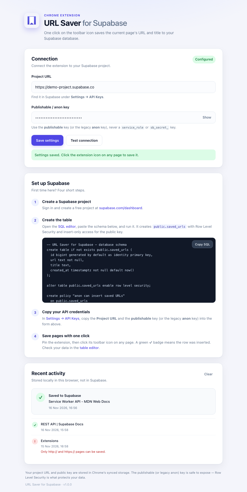

# URL Saver for Supabase

A small Chrome extension (Manifest V3, no build step, no dependencies) that
saves the current tab's **URL** and **title** to a Supabase table with a single
click on the toolbar icon.


Here's the settings page (shown with demo data):



## Features

- **One-click save** — clicking the toolbar icon inserts the current page; there
  is no popup to fill in.
- **Visual feedback** — the badge shows `…` while saving, `✓` on success, `!` on
  failure, and `?` when Supabase is not configured yet.
- **Simple setup** — enter your Supabase project URL and publishable key on the
  options page, test the connection, and you're done.
- **RLS-ready** — the included schema lets the public key insert rows but not
  read them.
- **Local activity log** — the options page shows the last 20 save attempts,
  stored only in Chrome.
- **Copy-paste SQL** — the schema ships with the extension and can be copied
  from the options page.

## Quick start

### 1. Create the database table

1. Open your [Supabase dashboard](https://supabase.com/dashboard) and create a
   project (the free tier is fine).
2. Go to **SQL Editor**.
3. Copy the contents of [`supabase/schema.sql`](supabase/schema.sql), paste it
   into the editor, and click **Run**.

This creates `public.saved_urls`, enables Row Level Security, and grants the
`anon` role permission to insert only.

### 2. Load the extension

1. Open `chrome://extensions` in Chrome.
2. Turn on **Developer mode** (top right).
3. Click **Load unpacked** and select this folder.
4. The settings page opens automatically. If it doesn't, click **Details** on
   the extension, then **Extension options**.

### 3. Connect Supabase

1. In Supabase, open **Settings → API Keys**.
2. Copy the **Project URL** and the **publishable** key (starts with
   `sb_publishable_`). Legacy projects can use the **anon** key instead.
3. Paste both into the extension's settings page and click **Save settings**.
4. Click **Test connection** to confirm everything works.

> Supabase is deprecating legacy `anon` keys by the end of 2026. New projects
> should use a publishable key; both keys map to the same `anon` database role
> and work with the included RLS policy.

### 4. Use it

Pin the extension to the toolbar, open any `http://` or `https://` page, and
click the icon. A green `✓` means the row was inserted. Confirm in Supabase
under **Table Editor → saved_urls**.

## What gets saved

| Column       | Type          | Notes                          |
| ------------ | ------------- | ------------------------------ |
| `id`         | `bigint`      | Identity primary key           |
| `url`        | `text`        | The page URL                   |
| `title`      | `text`        | The page title (may be `null`) |
| `created_at` | `timestamptz` | Set by the database            |

Every click inserts a new row, so revisiting the same URL creates another entry.
If you prefer one row per URL, add a unique constraint and change the request
headers to deduplicate (see [Customization](#customization)).

## How it works

1. Clicking the toolbar icon fires `chrome.action.onClicked` in
   [`background.js`](background.js).
2. The service worker reads the active tab's URL/title, loads your credentials
   from `chrome.storage.sync`, and sends
   `POST {project-url}/rest/v1/saved_urls` with the public key.
3. Row Level Security allows the insert but blocks reads.
4. The badge and the local activity log show the result.

No data passes through any third-party server other than your own Supabase
project. There is no analytics, tracking, or remote code.

## Permissions

| Permission                        | Why                                                           |
| --------------------------------- | ------------------------------------------------------------- |
| `activeTab`                       | Read the current tab's URL and title only after you click.    |
| `storage`                         | Save your Supabase credentials locally and keep a local log.  |
| `https://*.supabase.co/*` (host)  | Send the insert request to your Supabase project.             |

The extension does **not** request `tabs` or `<all_urls>`, so it has no access
to your browsing history.

## Security notes

- **Never use a `service_role` or `sb_secret_` key.** It bypasses Row Level
  Security, and anyone who unpacks the extension can read it. The settings page
  rejects keys that look like secrets.
- The publishable (or legacy anon) key is designed to be public. The included
  RLS policy is what keeps your data safe: anonymous clients can insert, but not
  select.
- Because the key is public, someone who extracts it could insert spam rows.
  This is fine for personal use. For a widely distributed extension, add
  Supabase Auth so each user gets their own rows and tighter policies.
- The optional read policy at the bottom of `schema.sql` is commented out. If
  you enable it, anyone with the public key can read every saved row.
- Credentials are stored in `chrome.storage.sync`, which is tied to your Chrome
  profile. Use **Clear** on the activity card to remove the local save log.

## Customization

- **Table name**: change `TABLE` in [`background.js`](background.js) and the
  query in [`options.js`](options.js), then update `schema.sql` to match.
- **Extra columns** (for example `notes` or `favicon_url`): add the column in
  Supabase, then include it in the `body` in `background.js`.
- **Deduplicate URLs**: create a unique index on `url` and add
  `Prefer: resolution=ignore-duplicates` to the insert headers. The schema uses
  `Prefer: return=minimal`, so add a comma-separated resolution value there.
- **Self-hosted Supabase or a custom domain**: add your URL to
  `host_permissions` in [`manifest.json`](manifest.json), for example
  `"https://supabase.example.com/*"`.
- **Icons**: edit or rerun [`tools/make-icons.py`](tools/make-icons.py) with
  `python3 tools/make-icons.py` (standard library only).

## Troubleshooting

| Symptom | Likely fix |
| ------- | ---------- |
| `?` badge and the settings page opens | Credentials are missing. Complete step 3. |
| Red `!` badge | Hover the icon or open the options page to see the last error. |
| "Supabase rejected the API key" | Use the **publishable** key (or legacy **anon** key), not a secret/service key. |
| "Table saved_urls was not found" | Run `supabase/schema.sql` in the SQL editor. |
| "Row Level Security blocked the insert" | Run the insert policy from `schema.sql`. |
| "Could not reach Supabase" | Check the Project URL (no `/rest/v1` suffix needed) and your connection. |
| `!` on a Chrome page | `chrome://`, `file://`, and extension pages cannot be saved. |
| Test passes but saves fail | The table test only checks read access; make sure the insert policy and grants from `schema.sql` were applied. |

## File map

```
manifest.json           Manifest V3 definition
background.js           One-click save + badge feedback
options.html            Settings and setup UI
options.css             Options page styling
options.js              Options page logic
supabase/schema.sql     Database table, RLS policy, and grants
icons/                  16/32/48/128 px icons
docs/options-page.png   Settings page screenshot
tools/make-icons.py     Icon generator (standard library only)
```

## Development

There is no build step. After changing files, open `chrome://extensions` and
click the reload button on the extension card. For background changes, also
click **Service worker** in the extension details to inspect its console.

Basic checks:

```bash
node --check background.js
node --check options.js
python3 tools/make-icons.py
```
